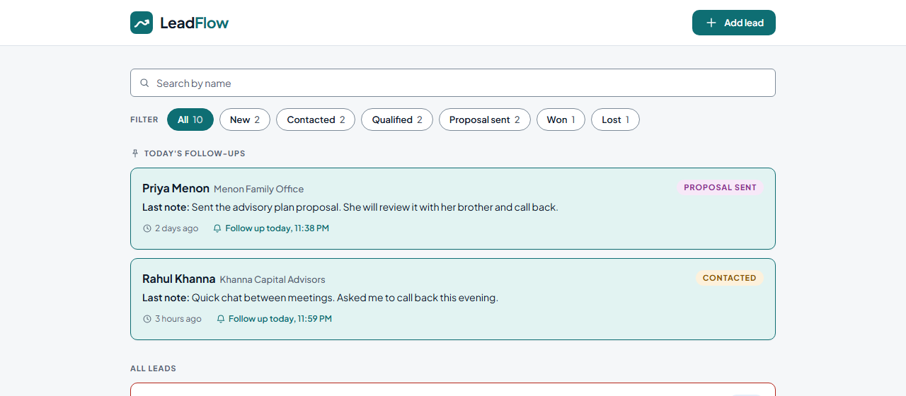
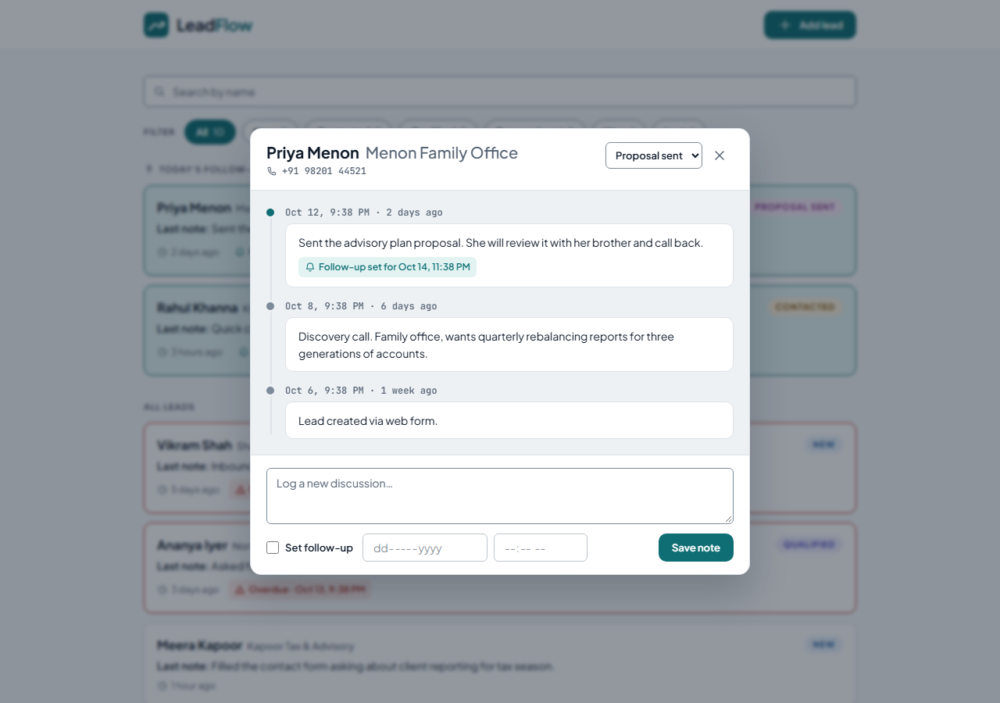
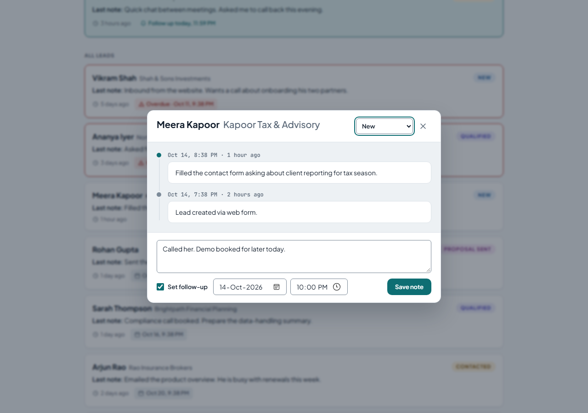
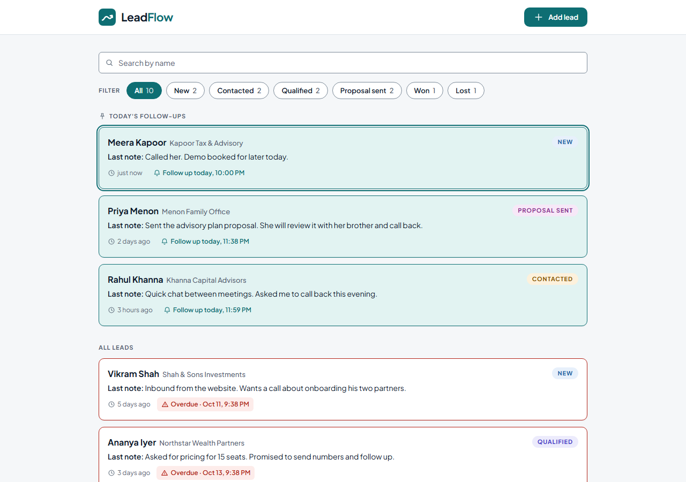
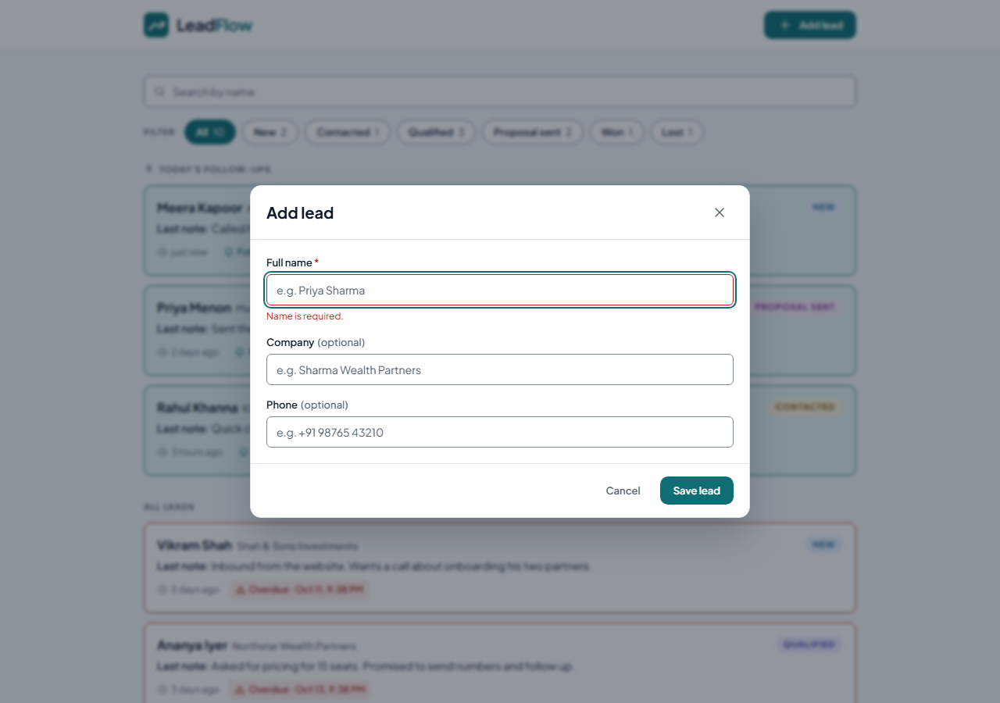
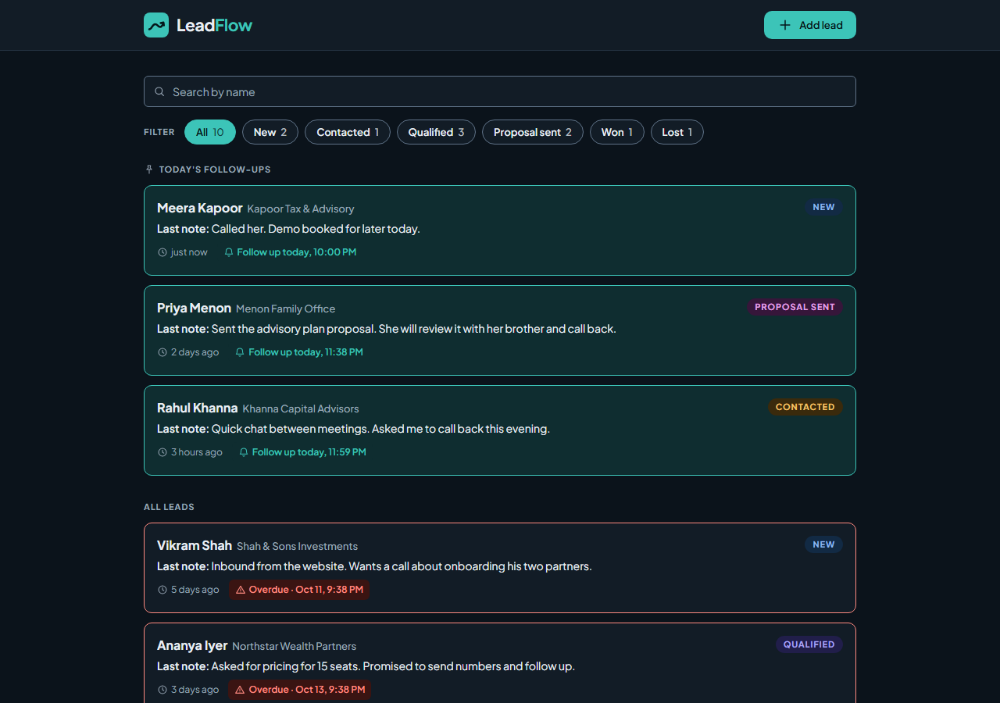
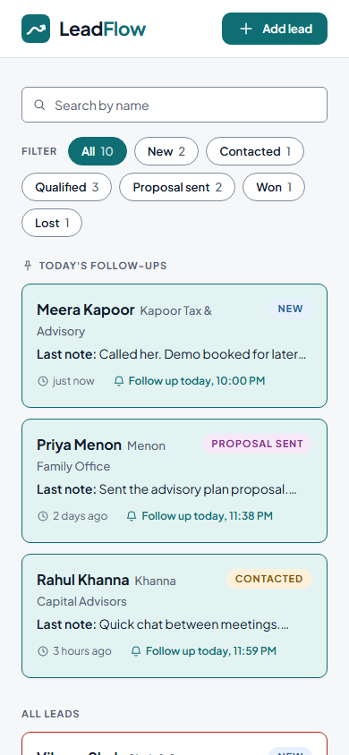
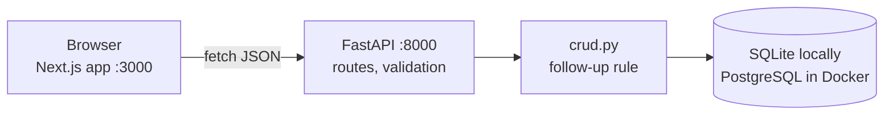
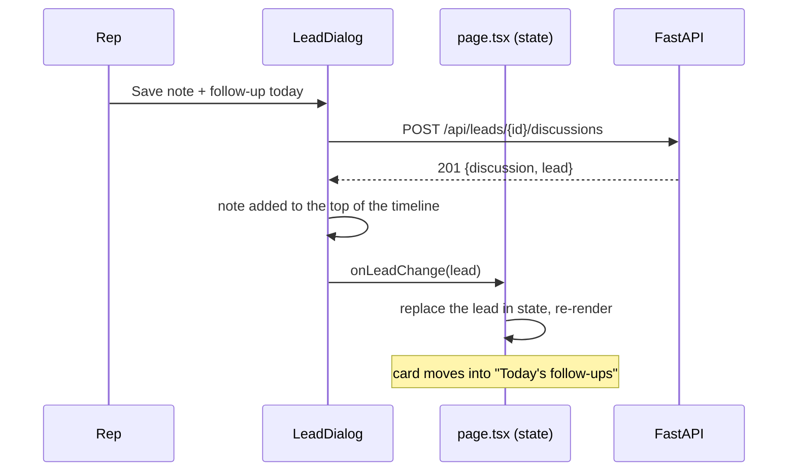

<div align="center">

<picture>
  <source media="(prefers-color-scheme: dark)" srcset="leadflow-brand-kit/assets/Logos/leadflow-wordmark-dark.svg">
  
</picture>

### Every lead, every conversation, every follow-up, on time.

A single-screen lead manager for sales reps and advisors: track leads, log every discussion and never miss a follow-up.


[Features](#features) · [Quick start](#quick-start) · [How it works](#how-it-works) · [API](#api) · [Testing](#testing) · [Project structure](#project-structure)

</div>

---



Built for the **PravarAI AI-smart full-stack intern assessment**. Demo video: _link to be added_.

## Features

### Required

| | Feature |
| :---: | --- |
| ✅ | **Lead list**: name, status badge, last discussion note, time since that note |
| ✅ | **Filter by status**: New, Contacted, Qualified, Proposal sent, Won, Lost, with counts |
| ✅ | **Today's follow-ups pinned** at the top, earliest first |
| ✅ | **Timeline dialog** (not a new page): full discussion history, newest first |
| ✅ | **Log a discussion** with an optional follow-up date and time |
| ✅ | **The list updates immediately** after saving: no reload, no extra request |
| ✅ | **Status changes** from the dialog and persists |
| ✅ | **Add a lead**: name required, company and phone optional, status starts as New |

### Bonus

| | Feature |
| :---: | --- |
| ✅ | **Search** leads by name as you type |
| ✅ | **Overdue follow-ups in red** (never for Won or Lost leads) |
| ✅ | **Docker Compose**: PostgreSQL + API + web app in one command |
| ✅ | **Seed script**: 10 realistic leads with 30 discussions covering every status and follow-up state |
| ✅ | **Filters** that apply to both sections |
| ✅ | Light and dark mode, responsive down to phone width, keyboard accessible dialogs |
| ✅ | GitHub Actions CI: tests, lint, type check, build and a Docker Compose smoke test |
| ⬜ | Login (optional in the brief, not built) |

## Screenshots

| Timeline dialog | Logging a note with a follow-up | The list updates at once |
| :---: | :---: | :---: |
|  |  |  |
| **Add lead with validation** | **Dark mode** | **Mobile** |
|  |  |  |

More in [`docs/screenshots/`](docs/screenshots/).

## Quick start

### Option A: Docker (one command)

Requires Docker Desktop.

```bash
cp .env.example .env          # Windows PowerShell: Copy-Item .env.example .env
docker compose up --build
```

| Open | |
| --- | --- |
| http://localhost:3000 | the app |
| http://localhost:8000/docs | interactive API docs |

The first start creates the database and seeds 10 demo leads. Data is kept in a Docker volume; `docker compose down -v` deletes it. Set `TZ` in `.env` to your timezone (e.g. `Asia/Kolkata`) so the demo's "later today" follow-ups fall on your today.

### Option B: run it locally

Requires Python 3.11+ with [uv](https://docs.astral.sh/uv/), and Node.js 20.9+.

**API** (terminal 1):

```bash
cd backend
uv venv .venv --python 3.12
uv pip install -r requirements.txt
cp .env.example .env               # Windows: Copy-Item .env.example .env
uv run python seed.py              # 10 demo leads (add --reset to start over)
uv run uvicorn app.main:app --reload --port 8000
```

**Web app** (terminal 2):

```bash
cd frontend
npm ci
cp .env.example .env.local         # Windows: Copy-Item .env.example .env.local
npm run dev
```

> Use one option at a time: both use ports 3000 and 8000. If another Python virtual environment is active in your terminal, run `deactivate` first, because `uv run` prefers an active environment.

## How it works



**One screen, one state.** `app/page.tsx` keeps the leads in React state and every request goes through `lib/api.ts`. The timeline and the add-lead form are native `<dialog>` elements over the list.

**"Updates immediately".** Saving a note returns the new note **and** the updated lead. The page swaps that lead into its state, React redraws, and the card moves between sections:



**Follow-up rules.**

| Situation | Result |
| --- | --- |
| Note saved **with** a follow-up | The lead's follow-up becomes that time (it must be in the future) |
| Note saved **without** one, follow-up time already **passed** | Follow-up cleared: the rep followed up |
| Note saved **without** one, follow-up in the **future** | Follow-up kept |
| Follow-up time has passed | **Overdue**: red border and chip (never for Won or Lost) |
| Follow-up on today's date | Pinned in **Today's follow-ups**, earliest first |

All times are stored in UTC and shown in the browser's own timezone.

## API

Interactive docs at **http://localhost:8000/docs**.

| Method | Path | Purpose | Success | Errors |
| --- | --- | --- | :---: | :---: |
| `GET` | `/api/health` | Health check | 200 | |
| `GET` | `/api/leads?status=&search=` | List leads with their latest note; optional status filter and name search | 200 | 422 |
| `POST` | `/api/leads` | Create a lead | 201 | 422 |
| `GET` | `/api/leads/{id}` | One lead | 200 | 404, 422 |
| `PATCH` | `/api/leads/{id}` | Update status or other fields (only the fields sent change) | 200 | 404, 422 |
| `DELETE` | `/api/leads/{id}` | Delete a lead and its notes | 204 | 404 |
| `GET` | `/api/leads/{id}/discussions` | Timeline, newest first | 200 | 404 |
| `POST` | `/api/leads/{id}/discussions` | Add a note with an optional follow-up; returns `{discussion, lead}` | 201 | 404, 422 |

Errors always look like `{"detail": "Lead not found"}`; validation errors list the field (`loc`) and message. Unexpected errors return a generic 500 and are only logged on the server.

## Environment variables

| Variable | Used by | Example | Purpose |
| --- | --- | --- | --- |
| `DATABASE_URL` | API | `sqlite:///./leadflow.db` | Database URL (Docker builds a PostgreSQL URL itself) |
| `CORS_ORIGINS` | API | `http://localhost:3000` | Origins allowed to call the API |
| `SEED_ON_STARTUP` | API | `true` | Seed demo data when the database is empty |
| `TZ` | API (Docker) | `Asia/Kolkata` | Timezone the seed uses for "today" |
| `NEXT_PUBLIC_API_URL` | web app | `http://localhost:8000` | API address as the browser sees it (set at build time) |
| `POSTGRES_USER` / `POSTGRES_PASSWORD` / `POSTGRES_DB` | Docker | `leadflow` / `change-me` / `leadflow` | PostgreSQL credentials |

Every variable is listed with a comment in [`.env.example`](.env.example), plus [`backend/.env.example`](backend/.env.example) and [`frontend/.env.example`](frontend/.env.example) for Option B. Real `.env` files are never committed.

## Testing

```bash
cd backend && uv run pytest     # 36 tests: every endpoint, status codes, validation, follow-up rules, seed
cd frontend && npm test         # 12 tests: today / overdue / upcoming rules, sorting, time formatting
```

Lint and types: `uv run ruff check .`, `npm run lint`, `npx tsc --noEmit`. CI runs all of this plus a Docker Compose smoke test on every push ([`.github/workflows/ci.yml`](.github/workflows/ci.yml)).

A full manual test plan (API by hand, every feature in the browser, edge cases, keyboard, dark mode, mobile, Docker, fresh setup) with copy-ready commands: **[`docs/TESTING.md`](docs/TESTING.md)**.

## Project structure

```
LeadFlow/
├── backend/                    FastAPI API
│   ├── app/
│   │   ├── main.py             app setup, CORS, error handling, startup
│   │   ├── config.py           settings from environment / .env
│   │   ├── database.py         database connection, UTC datetime type
│   │   ├── models.py           Lead, Discussion tables
│   │   ├── schemas.py          request/response shapes and validation
│   │   ├── crud.py             database operations and the follow-up rule
│   │   └── routers/leads.py    all /api/leads endpoints
│   ├── tests/                  pytest suite
│   ├── seed.py                 demo data (--reset to start over)
│   ├── requirements.txt        pinned Python dependencies
│   └── Dockerfile
├── frontend/                   Next.js web app
│   ├── app/                    layout (fonts), page (the one screen), brand styles, favicon
│   ├── components/             LeadList, LeadCard, LeadDialog, Timeline, NoteForm,
│   │                           AddLeadDialog, FilterChips, SearchBar, Dialog, ...
│   ├── lib/                    api.ts, time.ts (+ tests), status.ts, types.ts
│   └── Dockerfile
├── leadflow-brand-kit/         design system the UI follows (tokens, logos, icons, rules)
├── docs/
│   ├── TESTING.md              manual test plan
│   ├── AI_USAGE.md             how AI was used, phase by phase
│   └── screenshots/
├── .github/workflows/ci.yml    CI
├── docker-compose.yml
└── .env.example
```

## Design decisions

- **SQLite locally, PostgreSQL in Docker**: zero setup for development and tests, a real server database in Compose; only `DATABASE_URL` changes.
- **Overdue leads stay in "All leads"** (at the top) instead of a third section, matching the brand kit and wireframes.
- **Search runs in the browser**: all leads are already loaded for the filter counts, so it is instant and the counts always match. The API supports `?search=` and `?status=` too.
- **Native `<dialog>`**: focus trapping, Esc and the backdrop come from the browser, with no UI library.
- **No state library**: React state plus one small API client is enough for one screen.

## How AI was used

Built with **Claude Code** as a pair programmer, phase by phase from a written plan: tests first on the backend, current library docs checked before writing code, two reviews by a separate reviewer agent, and every flow verified in a real browser. What the AI generated, what I decided or changed, and every mistake it made and how it was fixed are in **[`docs/AI_USAGE.md`](docs/AI_USAGE.md)**.

## Limitations and ideas

- No login (optional in the brief). Next step: email/password login with a JWT.
- The list loads all leads at once: fine for a rep's few hundred leads; larger lists would need pagination.
- Tables are created on startup; a growing schema would need migrations (Alembic).
- Ideas that fit PravarAI: an **AI summary** of a lead's discussions, a **suggested next action** and follow-up time from the latest notes, and a daily digest of today's and overdue follow-ups.

## Credits

The interface follows the **LeadFlow brand kit** in [`leadflow-brand-kit/`](leadflow-brand-kit/): colours, typography (Plus Jakarta Sans, JetBrains Mono), icons and component rules. Layout inspired by the wireframes in the PravarAI assessment brief.
